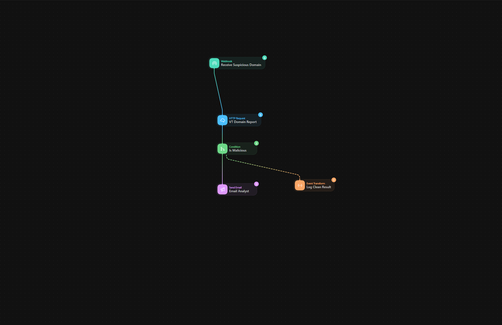
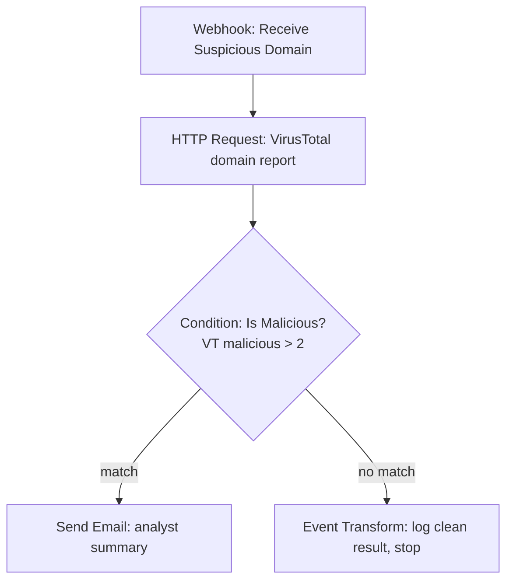
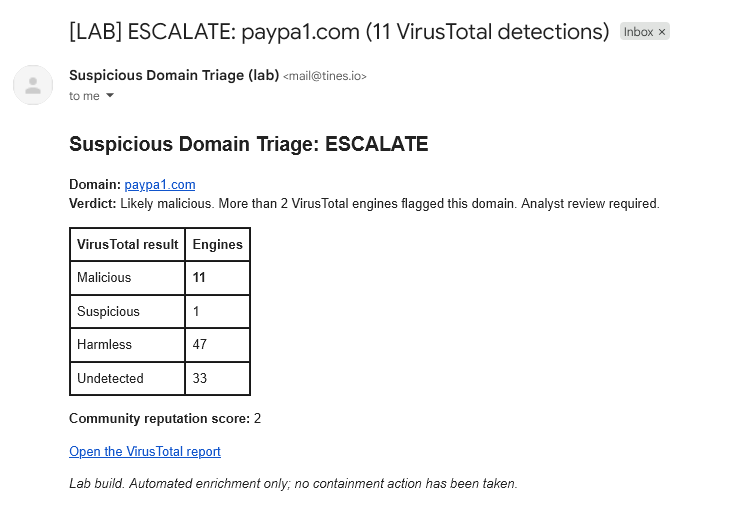

# Suspicious Domain Triage (Tines SOAR lab build)

> **Lab build, not production.** Built on a free Tines Community Edition tenant as a first SOAR implementation of the domain-triage logic from my capstone. It has never handled real alerts.

An analyst POSTs a suspicious domain to a webhook. The workflow looks the domain up in **VirusTotal**, applies a detection threshold, and either emails an analyst an evidence summary or logs the clean result and stops.

```bash
curl -X POST "$TINES_WEBHOOK_URL" -H 'Content-Type: application/json' -d '{"domain": "paypa1.com"}'
```



**Platform:** Tines (Community Edition). This is not Splunk SOAR.

---

## How it works



| Step | Tines action | What it does |
|---|---|---|
| Receive Suspicious Domain | Webhook | Entry point: "analyst reports something suspicious." Secret-authenticated URL. |
| VT Domain Report | HTTP Request | `GET https://www.virustotal.com/api/v3/domains/{domain}` with the API key in the `x-apikey` header. |
| Is Malicious | Condition | Escalates if more than 2 engines rate the domain malicious. |
| Email Analyst | Send Email | HTML summary: domain, verdict, detection breakdown, link to the VirusTotal report. |
| Log Clean Result | Event Transform | Records the clean verdict and the evidence, then stops. No notification. |

The configuration for each action is in [`actions/`](actions/), one JSON file per action, numbered in build order.

---

## Threshold: why "more than 2"

<!-- TODO: rewrite in your own words, using the reasoning from your capstone. -->

A domain is escalated when **3 or more** VirusTotal engines classify it as malicious.

- **Why not 1?** One or two detections out of roughly 90 engines are often noise: a single vendor with aggressive heuristics, or a stale listing. Escalating on one detection would flood an analyst with false positives.
- **Why not higher?** The output is a notification to a human, not an automated block. A false positive costs an analyst a few minutes; a missed phishing domain costs much more. So the bar is set to favor catching threats.
- **Only `malicious` counts.** The `suspicious` count is shown in the email for context but isn't scored, because it is too noisy to act on alone.
- **Known blind spot:** a phishing domain registered a few hours ago often has zero detections. That is the main reason for the additional sources listed below.

---

## Design decisions

- **API key stored in Tines Credentials,** referenced as `CREDENTIAL.virustotal_api_key`, never pasted into the action.
- **"Unknown" is not treated as an error.** VirusTotal returns HTTP 404 for a domain it has never seen. The workflow treats that as zero detections and routes it to the clean branch, logging `known_to_virustotal: false` so the gap is visible.
- **Rate limits are expected.** The VirusTotal request retries automatically on HTTP 429, because the free API allows only a few requests per minute.

---

## Testing

<!-- TODO: fill in the "Actual" column after running each test. -->

| Input | Expected | Actual |
|---|---|---|
| `example.com` | Clean branch, logged, no email | TODO |
| `paypa1.com` | Depends on current VirusTotal data | TODO |
| a never-registered domain, e.g. `nx-test-12345-abc.com` | VirusTotal 404, clean branch, `known_to_virustotal: false` | TODO |
| a domain currently listed on URLhaus or OpenPhish | Escalated, email sent | TODO |



---

## Honest limitations

- **Lab only:** single tenant, free tier, no production traffic.
- **One intelligence source.** A single source is a single point of failure, and VirusTotal is weakest on very new domains.
- **Free-tier API limits.** VirusTotal's public API is rate-limited and capped daily, so this can't handle a burst of submissions.
- **No input cleanup.** Defanged input such as `hxxps://paypa1[.]com` isn't converted; the domain must be submitted plainly.
- **Threshold is reasoned, not measured.** It hasn't been validated against a labeled set of real alerts. <!-- TODO: if your capstone measured accuracy, say so here instead. -->
- **No caching:** the same domain submitted twice makes two API calls.

---

## What I'd add next

1. **Google Safe Browsing** as a second source with a low false-positive rate.
2. **AbuseIPDB**, after resolving the domain to an IP, since AbuseIPDB scores IPs rather than domains.
3. **Input normalization and validation:** refang `[.]`, strip `hxxp://` and paths, reject non-domains before spending API quota.
4. **Domain age** from VirusTotal's creation date, to cover the "brand-new phishing domain" blind spot.
5. **Ticket creation** in Jira, ServiceNow, or Tines Cases on escalation.
6. **A false-positive feedback button** in the email that adds the domain to an allowlist, so thresholds can be tuned with data.
7. **Endpoint isolation behind human approval,** never automatic.
